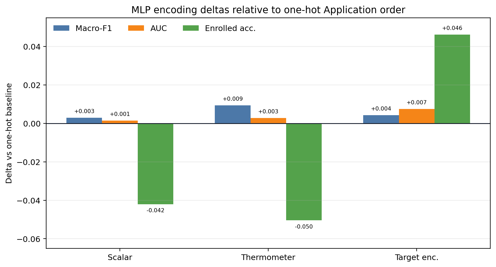
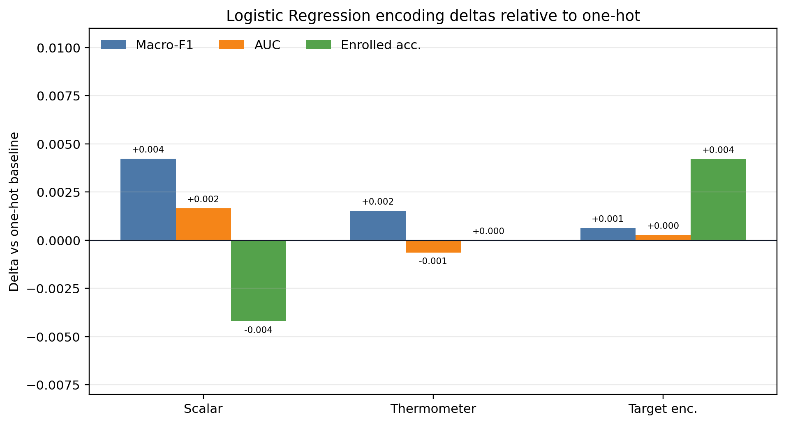
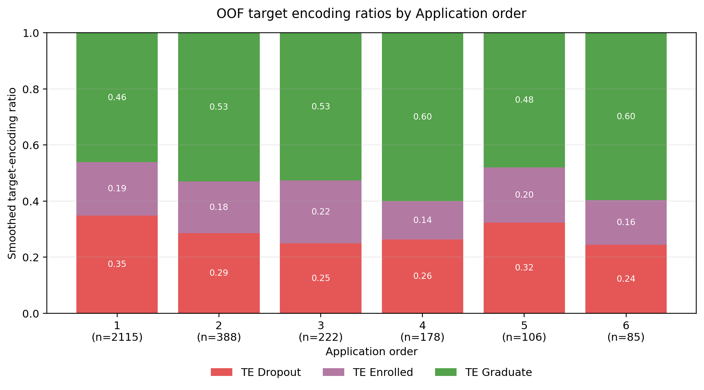

# Final Report Analysis Themes

## 1. 为什么 GBDT 取得最高分数

当前最高的单次 boosted-tree 结果来自 `gbdt_log_loss`：

| source | model | seed | accuracy | macro-F1 | AUC | dropout F1 | enrolled F1 | graduate F1 |
| --- | --- | ---: | ---: | ---: | ---: | ---: | ---: | ---: |
| `models/metrics/boost/classic_boosting_cross_seed_metrics.csv` | `gbdt_log_loss` | 62 | 0.7937 | 0.7501 | 0.9058 | 0.8144 | 0.5638 | 0.8723 |

需要在汇报里说明：这个结果来自 cross-seed 实验中的 seed 62，高于很多固定划分实验，但跨 split 比较时要标注评估口径。

GBDT 取得高分的核心原因：

- 该数据是典型表格数据，包含强非线性阈值关系，例如学期通过数、成绩、缴费状态、年龄、申请路径等。
- GBDT 逐轮拟合前一轮残差，能对少数困难样本区域做局部修正，比单棵树、线性模型更适合这种混合机制数据。
- `log_loss` 多分类目标直接优化概率质量分布，通常比只优化硬分类更利于 AUC 和后续 ensemble。
- Enrolled 类处在 Dropout 和 Graduate 中间，边界模糊；GBDT 的局部阈值组合可以比线性模型更好地捕捉这类非线性过渡区。

建议讲法：

> GBDT 的优势不是“树更强”，而是它把学生轨迹拆成了多个局部风险区域，并通过残差迭代不断修补最难的 Enrolled/Graduate 边界。

## 2. 什么 ensemble 取得最佳成果

最适合作为最终汇报主 ensemble 的结果是 OOF probability ensemble with semester members：

| source | model | accuracy | macro-F1 | AUC | dropout F1 | enrolled F1 | graduate F1 |
| --- | --- | ---: | ---: | ---: | ---: | ---: | ---: |
| `models/metrics/ensemble/oof_probability_ensemble_semester_members_metrics.csv` | `oof_probability_ensemble_semester_members_test` | 0.7824 | 0.7343 | 0.9013 | 0.7867 | 0.5487 | 0.8674 |

这不是一个“把所有模型平均”的 ensemble，而是一个 **OOF probability weighted ensemble**：

- 先用 cross-validation 产生每个成员在训练集上的 OOF probability。
- 在 OOF probability 上搜索成员权重，目标是最大化 OOF macro-F1。
- 权重确定后，只在 held-out test 上评估一次，避免用 test 反复调权重。

最终 semester-member ensemble 的权重为：

| member | weight | role |
| --- | ---: | --- |
| `catboost_tuned_semester` | 0.50 | 主力成员，负责类别特征和学期特征交互 |
| `lightgbm_tuned` | 0.30 | 稳定的树模型概率补充 |
| `tabpfn` | 0.20 | 高层表格 prior / 非树模型补充 |
| `catboost_tuned` | 0.00 | 被 semester 版本替代 |
| `multiview_gated_mlp_best` | 0.00 | OOF 权重搜索后未被选中 |
| `lightgbm_tuned_semester` | 0.00 | 与已选 LightGBM / CatBoost semester 信息重叠 |

权重来源：`models/metrics/ensemble/oof_probability_ensemble_semester_members_best_weights.json`。

对比其他 ensemble：

| source | model | accuracy | macro-F1 | AUC | note |
| --- | --- | ---: | ---: | ---: | --- |
| `models/metrics/ensemble/oof_probability_ensemble_metrics.csv` | `oof_probability_ensemble_test` | 0.7869 | 0.7320 | 0.9041 | AUC 更高，macro-F1 略低 |
| `models/metrics/ensemble/machine_only_ensemble_metrics.csv` | `machine_only_ensemble_test` | 0.7696 | 0.7247 | 0.8982 | 纯 ML 版本，稳但不最高 |
| `models/metrics/ensemble/cross_seed_stacking_metrics.csv` | `cross_seed_soft_average_test` | n/a | 0.7247 | n/a | test 未超过 OOF semester ensemble |
| `models/metrics/ensemble/cross_seed_stacking_metrics.csv` | `cross_seed_stacking_test` | n/a | 0.7172 | n/a | stacking 在 held-out 上退化 |

### 为什么这个 ensemble 最好

第一，基模型互补性比较强。`catboost_tuned_semester`、`lightgbm_tuned`、`tabpfn` 的错误模式不同：

- CatBoost 对类别特征和类别-数值交互更强，尤其适合 `Course`、`Application mode`、父母职业/学历这类离散变量。
- LightGBM 提供稳定的 boosted-tree 概率输出，擅长捕捉学期成绩、通过数、缴费状态等连续/阈值型结构。
- TabPFN 虽然单独 macro-F1 不一定最高，但它提供了和传统树模型不同的 probability prior，因此在 OOF 权重里保留了 0.20。

第二，semester-member 版本加入了更贴近业务机制的特征视角。学生结果强依赖第一、第二学期的 enrolled / approved / grade / evaluation 等变量。`catboost_tuned_semester` 获得 0.50 权重，说明 OOF 搜索认为“学期特征交互 + CatBoost 类别处理”是最有增益的成员。相比普通 `oof_probability_ensemble_test`，semester-member test macro-F1 从 `0.7320` 提到 `0.7343`。

第三，融合的是 probability，不是 hard label。Enrolled 类处在 Dropout 与 Graduate 之间，很多样本不是“一个模型完全对、另一个完全错”，而是概率质量分配不同。Probability ensemble 可以把各模型对 Enrolled 的中间态判断合并起来，所以该 ensemble 的 Enrolled F1 达到 `0.5487`，高于很多单模型。

第四，OOF 权重比 test 调权更可信。权重搜索只看训练集 OOF prediction，held-out test 只用一次。这样可以讲成一个无泄漏流程：`train folds -> OOF probabilities -> weight search -> final test`。

### 为什么不用 stacking 作为主结果

Stacking 的问题不是没有尝试，而是 held-out 上退化：

- `cross_seed_soft_average_test` macro-F1 为 `0.7247`。
- `cross_seed_stacking_test` macro-F1 为 `0.7172`。

这说明二层 stacker 学到了一些 OOF/meta-feature 上的局部规律，但没有稳定迁移到 held-out test。对于这个数据集，样本量不大，Enrolled 类又少，stacker 的自由度反而容易过拟合。相比之下，简单的 OOF probability weighted ensemble 更低方差，更适合最终汇报。

最终推荐口径：

- 如果讲“稳定、可复现、无泄漏的最终 ensemble”，使用 `oof_probability_ensemble_semester_members_test`。
- 如果讲“单次最高分探索”，可以引用 `gbdt_log_loss` seed 62，但要说明它来自 cross-seed split。
- 如果讲“为什么不用 stacking”，强调 stacking OOF 看似不错，但 held-out test 下降，说明二层模型容易过拟合验证分布。

建议讲法：

> 最终 ensemble 不是简单堆模型，而是用 OOF 概率做权重搜索，再在 held-out test 上一次性评估。它的价值是降低泄漏风险，并把不同模型对 Enrolled 过渡区的判断进行概率融合。

## 3. MLP 的不同编码方式带来的影响

重点实验来自：

- `models/metrics/mlp/multiview_application_order_encoding_tuned_summary.csv`
- `models/metrics/mlp/multiview_application_order_encoding_search_onehot.csv`

| encoding | accuracy | macro-F1 | AUC | dropout acc | enrolled acc | graduate acc |
| --- | ---: | ---: | ---: | ---: | ---: | ---: |
| one-hot tuned | 0.7688 | 0.7256 | 0.8874 | 0.6885 | 0.6303 | 0.8703 |
| scalar tuned | 0.7718 | 0.7285 | 0.8889 | 0.7963 | 0.5882 | 0.8220 |
| thermometer tuned | 0.7824 | 0.7350 | 0.8903 | 0.7447 | 0.5798 | 0.8793 |
| target encoding OOF tuned | 0.7681 | 0.7299 | 0.8949 | 0.6956 | 0.6765 | 0.8477 |

相对 one-hot baseline 的 delta 图：

关键结论：

- One-hot 并不是 MLP 的最佳表达。它的 macro-F1 为 `0.7256`，低于 scalar 的 `0.7285`、thermometer 的 `0.7350` 和 OOF target encoding 的 `0.7299`。
- `Application order` 直接作为 scalar 会隐含等距假设，即第 1 志愿到第 2 志愿与第 8 到第 9 志愿的距离相同。
- Thermometer encoding 更适合表达有序但不严格等距的志愿顺序，重调参后 macro-F1 相比 one-hot 提高 `+0.0094`，相比 scalar 提高 `+0.0065`。
- Target encoding OOF 对 AUC 和 Enrolled acc 更友好；相比 one-hot，Enrolled acc 提高 `+0.0462`，但牺牲 Dropout acc，说明它更像概率排序增强，而不是硬分类最优。
- 未调参直接替换编码曾经变差，说明“编码方式”和“超参数”存在交互，不能只换表示不重新搜索。

### Logistic Regression 视角补充

为了验证这个现象是否只属于 MLP，额外补了一个 L2-regularized multinomial Logistic Regression 对照实验：

- 脚本：`scripts/baseline/compare_application_order_encodings_logistic.py`
- 指标：`models/metrics/baseline/logistic_application_order_encoding_metrics.csv`
- 网格：每种编码单独搜索 `C in [0.02, 0.05, 0.1, 0.2, 0.5, 1, 2, 5, 10]`
- 口径：同一 processed train/test split，5-fold CV 在 train 上选 `C`，最后评估 Training / Testing / Entire。

Testing 结果如下：

| encoding | best C | accuracy | macro-F1 | AUC | dropout F1 | enrolled F1 | graduate F1 |
| --- | ---: | ---: | ---: | ---: | ---: | ---: | ---: |
| scalar | 0.20 | 0.7500 | 0.7134 | 0.8887 | 0.7718 | 0.5315 | 0.8370 |
| one-hot | 0.05 | 0.7455 | 0.7092 | 0.8870 | 0.7657 | 0.5268 | 0.8350 |
| thermometer | 0.05 | 0.7470 | 0.7107 | 0.8864 | 0.7682 | 0.5286 | 0.8353 |
| OOF target encoding | 0.05 | 0.7455 | 0.7098 | 0.8873 | 0.7663 | 0.5293 | 0.8339 |

相对 one-hot baseline 的 Logistic Regression delta 图：

进一步做了 `Application order` 在 Logistic Regression 中的贡献率分析：

- 脚本：`scripts/baseline/analyze_logistic_application_order_contribution.py`
- 结果：`models/metrics/baseline/logistic_application_order_contribution.csv`
- 方法 1：统计 `Application order` 派生特征在最终 Logistic Regression 系数里的占比。
- 方法 2：grouped permutation importance，把 `Application order` 相关列整体打乱，看 held-out test 指标下降。

贡献率结果：

| encoding | transformed features | app-order features | coef abs share | coef L2 share | perm macro-F1 drop | perm AUC drop | perm Enrolled F1 drop |
| --- | ---: | ---: | ---: | ---: | ---: | ---: | ---: |
| scalar | 241 | 1 | 0.26% | 2.93% | 0.0052 | 0.0014 | 0.0101 |
| one-hot | 248 | 8 | 3.72% | 14.57% | 0.0037 | 0.0008 | 0.0072 |
| thermometer | 249 | 9 | 2.06% | 8.15% | 0.0046 | 0.0018 | 0.0095 |
| OOF target encoding | 243 | 3 | 0.70% | 3.76% | 0.0049 | 0.0016 | 0.0098 |

解释时要注意：系数占比不是绝对贡献率。One-hot / thermometer 会把一个变量拆成多列，所以系数占比天然会变大；这不等于预测贡献更大。更稳的解释是 permutation drop：

- `Application order` 对 Logistic Regression 有稳定但较小的正贡献。
- 打乱它后 macro-F1 大约下降 `0.004` 到 `0.005`，Enrolled F1 大约下降 `0.007` 到 `0.010`。
- 这说明它主要是一个辅助性边界特征，不是决定模型性能的主信号。

### OOF Target Encoding 的类别比例是否均衡

额外拆解了 `Application order` 的 OOF target encoding class ratio：

- 脚本：`scripts/baseline/analyze_application_order_target_encoding_ratios.py`
- order-level ratio：`models/metrics/baseline/application_order_class_ratios_for_target_encoding.csv`
- OOF encoding by true class：`models/metrics/baseline/application_order_oof_target_encoding_by_true_class.csv`
- summary：`models/metrics/baseline/application_order_target_encoding_balance_summary.csv`

训练集全局类别比例为：

| class | global train ratio |
| --- | ---: |
| Dropout | 0.3211 |
| Enrolled | 0.1796 |
| Graduate | 0.4994 |

按 `Application order` 分组后，原始比例并不均衡，主要 order 基本都是 Graduate 占优：

| order | support | dropout raw | enrolled raw | graduate raw | dropout smoothed TE | enrolled smoothed TE | graduate smoothed TE |
| ---: | ---: | ---: | ---: | ---: | ---: | ---: | ---: |
| 1 | 2115 | 0.3489 | 0.1882 | 0.4629 | 0.3486 | 0.1902 | 0.4612 |
| 2 | 388 | 0.2809 | 0.1727 | 0.5464 | 0.2856 | 0.1841 | 0.5303 |
| 3 | 222 | 0.2342 | 0.2117 | 0.5541 | 0.2493 | 0.2242 | 0.5265 |
| 4 | 178 | 0.2472 | 0.1011 | 0.6517 | 0.2629 | 0.1371 | 0.6000 |
| 5 | 106 | 0.3208 | 0.1604 | 0.5189 | 0.3233 | 0.1970 | 0.4797 |
| 6 | 85 | 0.2000 | 0.0941 | 0.7059 | 0.2439 | 0.1591 | 0.5970 |

如果只汇报 OOF target encoding 后的比例，可以使用这张图：

`order=0` 和 `order=9` 在 train 中各只有 1 个样本，原始比例极端，但 smoothing 后会被强烈拉回全局先验附近，所以不能把它们当作可靠规则。

从平衡性看：

| item | Dropout | Enrolled | Graduate | note |
| --- | ---: | ---: | ---: | --- |
| global train class ratio | 0.3211 | 0.1796 | 0.4994 | 全局先验 |
| mean raw order ratio | 0.2040 | 0.2410 | 0.5550 | 按 order 不加权平均，Graduate 偏高 |
| mean smoothed TE ratio | 0.2945 | 0.1853 | 0.5202 | smoothing 后更接近全局先验 |

OOF target encoding 在不同真实类别上的均值也很接近：

| true class | support | TE Dropout mean | TE Enrolled mean | TE Graduate mean | encoded margin mean |
| --- | ---: | ---: | ---: | ---: | ---: |
| Dropout | 994 | 0.3297 | 0.1902 | 0.4801 | 0.1504 |
| Enrolled | 556 | 0.3284 | 0.1911 | 0.4806 | 0.1522 |
| Graduate | 1546 | 0.3221 | 0.1892 | 0.4886 | 0.1665 |

结论：

- `Application order` 的原始 class ratio 不均衡，且多数 order 都是 Graduate 占优。
- OOF target encoding 经过 smoothing 后更平衡，但也因此信号变弱。
- 三个真实类别对应的 OOF encoding 均值非常接近，说明它不能单独强区分 Dropout / Enrolled / Graduate。
- 这解释了为什么 OOF target encoding 在 Logistic Regression 中没有明显超过 scalar：它提供的是很弱的先验校正，而不是高分离度特征。

这个结果很有解释价值：编码确实影响 Logistic Regression，但这次最佳不是 thermometer，而是原始 scalar。原因可能是：

- Logistic Regression 只能学习全局线性边界，thermometer / one-hot 增加自由度后，在小数据和 Enrolled 少数类上未必能稳定转化为 held-out 增益。
- `Application order` 本身可能只有弱到中等信号，拆成多个稀疏阈值后提升了表达能力，但也放大了正则化压力，所以最佳 `C` 从 `0.20` 降到 `0.05`。
- MLP 的 nonlinear hidden layers 可以利用 thermometer 的阶梯结构形成交互；Logistic Regression 缺少这种交互建模能力，所以没有复制 MLP 的涨点。

因此这一节更准确的结论不是“thermometer 一定更好”，而是：

- 编码方式会改变模型的特征几何假设。
- 对 MLP，thermometer 在重调参后能提升 macro-F1。
- 对 Logistic Regression，这个改变没有带来 held-out 提升，说明表示变换必须和模型假设、正则强度一起讨论。

建议讲法：

> 编码实验的重点不是证明某一种编码永远最好，而是证明“特征表示假设”会改变模型行为。MLP 能从 thermometer order 中获得更好的非线性交互；而 Logistic Regression 在同样替换后没有提升，说明线性模型更受全局正则和样本量限制。

## 4. Course 171 outlier / subgroup

主要文档：`docs/findings/course_171_ctesp_creditation_subgroup.md`。

核心事实：

- `Course == 171` 对应 `Design de Animação e Multimédia`。
- `Course == 171` 且 12 个 curricular activity 字段全为 0 的样本共有 180 个：

| class | count |
| --- | ---: |
| Graduate | 75 |
| Dropout | 77 |
| Enrolled | 28 |

机制解释：

- 这个子群不像普通缺失值，更像 CTeSP-to-bachelor 或 credit recognition 路径造成的制度性特征形态。
- 学生可能因为已有课程/学分抵免，导致一年级活动列为 0，但并不代表没有学习轨迹。

为什么不能硬规则覆盖：

- 180 人中 Graduate 只有 75，不是纯 Graduate 群。
- CatBoost 对 75 个 true Graduate 子群也只预测 40 个 Graduate，平均 Graduate probability 约 0.371。
- `/tmp` 的 SVM 小样本实验中，holdout macro-F1 只有约 0.62，简单规则最好也只有约 0.69，稳定性不足。

推荐结论：

- 不做 `if Course171 zero curricular -> Graduate` 的硬覆盖。
- 更适合作为机制解释、uncertainty/report-only 标记、soft probability adjustment 或二阶段决策中的低风险辅助特征。

建议讲法：

> 这不是一个可以直接加分的硬规则，而是一个很有价值的机制发现：模型发现了一个制度路径子群，但这个子群内部仍然混合了三类学生。

## 5. SVM 去噪提升

主要文档：`docs/feature/svm_noise_feature_engineering.md`。

核心对比：

| model | accuracy | macro-F1 | AUC | enrolled recall | enrolled F1 |
| --- | ---: | ---: | ---: | ---: | ---: |
| dense SVM best | 0.7809 | 0.7249 | 0.8916 | 0.5168 | 0.5268 |
| dense drop-noise SVM best | 0.7854 | 0.7306 | 0.8910 | 0.5294 | 0.5396 |
| delta | +0.0045 | +0.0057 | -0.0006 | +0.0126 | +0.0128 |

去除的低价值/噪声特征：

- `Curricular units 1st sem (credited)`
- `Curricular units 2nd sem (credited)`
- `Curricular units 1st sem (without evaluations)`
- `Curricular units 2nd sem (without evaluations)`
- `International`
- `Educational special needs`

最优配置：

- feature set: `dense_drop_noise`
- kernel: `rbf`
- `C = 15.0`
- `gamma = 0.006`
- class weights: Dropout 1.0, Enrolled 1.25, Graduate 1.0

关键解释：

- SVM 尤其 RBF SVM 依赖距离度量，低信息维度会稀释真正有效的距离结构。
- 去噪后，Enrolled 的 recall 和 F1 提升更明显，说明边界模糊类更容易受噪声维度影响。
- 后续 SelectKBest 没有继续提升，说明本次收益来自有业务解释的目标去噪，而不是机械特征筛选。

建议讲法：

> 对树模型来说弱特征通常只是少用，对 SVM 来说弱特征会进入距离计算，因此“删掉坏维度”本身就是模型改进。

## 6. MoE v2 为什么能涨点

MoE v2 的核心不是普通 ensemble，而是 **supervised error-predicting router**。它不再给所有样本使用同一组全局权重，而是学习“当前样本应该更相信哪个专家”。

当前主版本是：

- expert pool: `catboost_tuned`, `lightgbm_hist_column_best`, `gbdt_log_loss`
- router: `logistic_router`
- router feature variant: `raw`
- weight mode: `none`
- routing: `soft`

单次 held-out 最好结果来自 `models/metrics/ensemble/supervised_error_router_moe_v2_best.json`：

| model | accuracy | macro-F1 | AUC | dropout F1 | enrolled F1 | graduate F1 |
| --- | ---: | ---: | ---: | ---: | ---: | ---: |
| `v2_raw_logistic_router_none_soft_test` | 0.7756 | 0.7318 | 0.8979 | 0.7851 | 0.5513 | 0.8589 |

跨 seed 后，MoE v2 的更稳健口径是：

| model | macro-F1 mean | macro-F1 std | AUC mean | enrolled F1 mean | enrolled recall mean |
| --- | ---: | ---: | ---: | ---: | ---: |
| LightGBM hist-column best | 0.7252 | 0.0041 | 0.8953 | 0.5332 | 0.5308 |
| MoE v2 soft routing | 0.7246 | 0.0084 | 0.8962 | 0.5386 | 0.5812 |
| MoE v2 hard routing | 0.7196 | 0.0140 | 0.8907 | 0.5344 | 0.5854 |
| CatBoost tuned | 0.7150 | 0.0076 | 0.8894 | 0.5332 | 0.6106 |

### 涨点来自哪里

第一，router 的监督信号更接近 ensemble 的真实目标。普通分类器学的是 `P(Y|X)`，但 MoE router 学的是“哪个 expert 对这个样本 true-class loss 最低”。也就是说，router 不是重新预测学生类别，而是在预测专家适配性。

第二，Core3 专家有互补性：

- `lightgbm_hist_column_best` 是最强稳定专家，负责大部分常规表格边界。
- `catboost_tuned` 更擅长类别变量和类别交互。
- `gbdt_log_loss` 对部分局部边界有补充，尤其在 cross-seed 中出现过很高单次分数。

训练集 pseudo-label 分配显示 router 不是坍缩到单一专家：

| expert | pseudo-label share |
| --- | ---: |
| `catboost_tuned` | 0.1528 |
| `lightgbm_hist_column_best` | 0.5420 |
| `gbdt_log_loss` | 0.3052 |

test hard route shares 也比较分散：

| expert | test hard route share |
| --- | ---: |
| `catboost_tuned` | 0.2937 |
| `lightgbm_hist_column_best` | 0.4639 |
| `gbdt_log_loss` | 0.2425 |

这说明 MoE v2 没有退化成“永远选择最强 LightGBM”，而是真的在做样本级专家分配。

第三，MoE v2 的收益主要体现在 Enrolled。跨 seed 下，MoE v2 soft 的 macro-F1 均值 `0.7246`，略低于 LightGBM hist-column best 的 `0.7252`；但 Enrolled recall 从 `0.5308` 提到 `0.5812`，Enrolled F1 从 `0.5332` 提到 `0.5386`。这说明它更愿意把边界模糊样本分配给能保住 Enrolled 的专家组合。

### 为什么 soft routing 比 hard routing 更适合汇报

Hard routing 只选一个 expert，Enrolled recall 更高，但 macro-F1 std 也更大：`0.0140`。Soft routing 使用 router probability 对专家概率加权，macro-F1 std 降到 `0.0084`，AUC 也更高。因此最终汇报建议使用 soft routing。

### 推荐讲法

> MoE v2 的涨点不是来自多堆一个模型，而是把 ensemble 从“全局固定权重”变成“样本级动态分配”。它没有稳定刷新全局最高 macro-F1，但显著改善 Enrolled 这类边界模糊样本，因此更适合被展示为机制型创新，而不是单纯 leaderboard 技巧。
