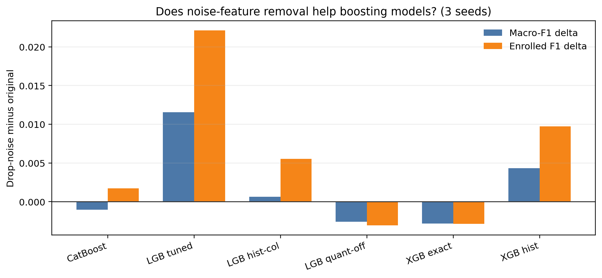

# Boost Models: Does Noise-feature Removal Help?

本实验用于回答：SVM 上有效的去噪特征删除，是否同样能提升 boosting 模型。

## Evaluation Setup

- 数据：`data/processed/train.csv + test.csv` 合并后重新 stratified split。
- Seeds：`42, 62, 82`。
- Test size：`0.3`。
- 输出：
  - `models/metrics/reporting/all_model_results_cross_seed_seed_level.csv`
  - `models/metrics/reporting/all_model_results_cross_seed_summary.csv`
- 脚本：
  - `scripts/reporting/compile_all_models_cross_seed_summary.py`

去噪列与 SVM 去噪实验一致：

- `Curricular units 1st sem (credited)`
- `Curricular units 2nd sem (credited)`
- `Curricular units 1st sem (without evaluations)`
- `Curricular units 2nd sem (without evaluations)`
- `International`
- `Educational special needs`

说明：CatBoost drop-noise 已在 CPU 资源释放后补跑，因此本表覆盖 CatBoost、LightGBM、XGBoost、GBDT/HistGB。

## Paired Delta

`delta = drop_noise - original`。

| model pair | Macro-F1 delta | Accuracy delta | AUC delta | Enrolled F1 delta | Enrolled recall delta |
| --- | ---: | ---: | ---: | ---: | ---: |
| CatBoost tuned | -0.0010 | -0.0018 | -0.0014 | +0.0017 | +0.0070 |
| LightGBM tuned | +0.0116 | +0.0090 | +0.0020 | +0.0221 | +0.0210 |
| LightGBM hist-column best | +0.0006 | -0.0008 | -0.0003 | +0.0056 | +0.0098 |
| LightGBM quantile-off tuned | -0.0026 | -0.0018 | -0.0003 | -0.0030 | -0.0042 |
| XGBoost exact one-hot tuned | -0.0028 | -0.0025 | +0.0003 | -0.0028 | -0.0014 |
| XGBoost hist best | +0.0043 | +0.0015 | -0.0026 | +0.0097 | +0.0084 |

## Noise-feature Diagnostics

为了判断这些列是否真的是“无信息噪声”，额外做了两类度量：

- 单变量统计度量：主值比例、正值比例、类别均值差、类别非零率差、mutual information、ANOVA F。
- 树模型使用度量：在 seed 42 split 上训练 CatBoost / LightGBM / XGBoost exact / GBDT，统计这 6 列合计占总 feature importance 的比例。

输出文件：

- `models/metrics/reporting/noise_feature_diagnostics_for_boost.csv`
- `models/metrics/reporting/noise_feature_tree_importance_seed42.csv`

### Single-feature Signal

| feature | dominant rate | positive rate | max mean gap | max nonzero gap | MI | ANOVA F |
| --- | ---: | ---: | ---: | ---: | ---: | ---: |
| Curricular units 1st sem (credited) | 0.8696 | 0.1304 | 0.3399 | 0.0141 | 0.0000 | 7.9794 |
| Curricular units 2nd sem (credited) | 0.8802 | 0.1198 | 0.3079 | 0.0267 | 0.0074 | 9.9745 |
| Curricular units 1st sem (without evaluations) | 0.9335 | 0.0665 | 0.1038 | 0.0429 | 0.0000 | 11.4373 |
| Curricular units 2nd sem (without evaluations) | 0.9363 | 0.0637 | 0.1573 | 0.0454 | 0.0000 | 20.1855 |
| International | 0.9751 | 0.0249 | 0.0077 | 0.0077 | 0.0000 | 0.6397 |
| Educational special needs | 0.9885 | 0.0115 | 0.0034 | 0.0034 | 0.0000 | 0.3209 |

解读：

- `International` 和 `Educational special needs` 几乎是 near-constant，正值率只有 `2.49%` 和 `1.15%`，MI 也为 0。它们更像纯弱信号列。
- `credited` / `without evaluations` 四列虽然主值比例很高，但不是完全无信号。尤其 `without evaluations` 的 ANOVA F 不低，说明它们可能携带少量 class-dependent 的稀有模式。
- 这些列对 SVM 是噪声，是因为它们进入了 RBF 距离计算；但对树模型来说，低频弱列不一定有害，因为树可以选择不用它。

### Tree-importance Usage

下面是 6 个 drop-noise 列合计占总 feature importance 的比例。

| model | importance type | noise-total share |
| --- | --- | ---: |
| CatBoost tuned | PredictionValuesChange | 0.0079 |
| LightGBM hist-column best | gain | 0.0106 |
| LightGBM hist-column best | split | 0.0139 |
| XGBoost exact one-hot | feature importance | 0.0305 |
| GBDT log-loss | sklearn feature importance | 0.0136 |

分列看，树模型确实使用了这些列，但使用比例很低：

| feature | CatBoost share | GBDT share | LightGBM share | XGBoost exact share |
| --- | ---: | ---: | ---: | ---: |
| Curricular units 1st sem (credited) | 0.0019 | 0.0018 | 0.0041 | 0.0062 |
| Curricular units 2nd sem (credited) | 0.0023 | 0.0030 | 0.0028 | 0.0063 |
| Curricular units 1st sem (without evaluations) | 0.0011 | 0.0046 | 0.0021 | 0.0072 |
| Curricular units 2nd sem (without evaluations) | 0.0025 | 0.0034 | 0.0014 | 0.0059 |
| International | 0.0000 | 0.0001 | 0.0002 | 0.0000 |
| Educational special needs | 0.0001 | 0.0007 | 0.0000 | 0.0049 |

注意：LightGBM 分列表使用 gain share；上面的总表同时报告了 gain 和 split 两种口径。更重要的是趋势：这些列在树模型中不是主驱动特征。

## Interpretation

去噪对 boosting **不是普适增益**，而是明显依赖模型和训练配置。

最明显受益的是 `lightgbm_tuned`：Macro-F1 提升约 `+0.0116`，Enrolled F1 提升约 `+0.0221`。这说明对于该 LightGBM 配置，删除低信息/稀有二值列确实减少了错误 split 或类别边界噪声。

`lightgbm_hist_column_best` 只小幅提升 Macro-F1 `+0.0006`，但 Enrolled F1 仍提升 `+0.0056`。这说明 hist-column best 本身已经通过 `max_bin` 和 column sampling 缓解了一部分噪声影响，继续删列收益有限。

`xgboost_exact_onehot_local_tuned` 反而下降 `-0.0028` Macro-F1。一个合理解释是：exact + one-hot 版本已经能较精确地处理稀疏类别/二值结构，删除这些列会损失少量边界信息。

`catboost_tuned` 的 Macro-F1 小降 `-0.0010`，AUC 小降 `-0.0014`，但 Enrolled F1 和 recall 略升。这说明 CatBoost 并不明显需要这组手工去噪；其原生类别处理和 split selection 已经能较好地控制弱特征，删列反而略损全局概率质量。

`xgboost_hist_best` 的 Macro-F1 提升 `+0.0043`，但 AUC 下降 `-0.0026`。这更像是分类阈值/硬标签层面的改善，而不是概率排序质量提升。

## Why It Does Not Work Reliably For Boosting

### 1. 树模型已经内置了 feature selection

SVM 会把所有输入维度都放进距离函数，因此 near-constant / low-signal 列会直接影响样本间距离。树模型不同：每次 split 都要和其他特征竞争 gain。若某个特征没有贡献，树可以自然少用或不用它。

这就是为什么 6 个 drop-noise 列在 CatBoost / LightGBM / GBDT 中的总 importance share 只有约 `0.8% - 1.4%`。对这类模型，删除弱列通常不会像 SVM 那样显著净化表示空间。

### 2. 这些列并非完全无信息

四个 curricular 列虽然稀疏，但不等于无信息。`credited` 和 `without evaluations` 可能对应特殊学习路径、学分抵免、异常注册状态、或 Course 171 这类机制子群。树模型擅长把这种稀有模式作为局部分裂条件使用。

因此删除它们会带来两种相反效应：

- 好处：减少弱 split 和偶然 split，尤其对某些 LightGBM 配置有帮助。
- 坏处：丢掉少数局部子群的有效规则，导致 XGBoost exact / CatBoost / LightGBM quantile-off 略降。

### 3. 不同 boosting 配置对噪声的敏感度不同

`lightgbm_tuned` 明显受益，说明它原始配置更容易被这些低频列影响；删除后 Macro-F1 和 Enrolled F1 都上升。

`lightgbm_hist_column_best` 收益很小，因为它已经通过 `max_bin` / column sampling 找到了较稳的列采样方式，弱列的负面影响被压低。

`xgboost_exact_onehot_local_tuned` 反而下降，因为 exact split + one-hot 对低频二值结构的处理更精细。这些列虽然弱，但可能仍给少数样本提供有效边界。

`catboost_tuned` 也略降，说明 CatBoost 的 split selection 已经能控制这些弱列；手工删除反而轻微损伤全局概率排序。

### 4. Macro-F1 和 AUC 的方向不总一致

`xgboost_hist_best` 去噪后 Macro-F1 上升，但 AUC 下降。这说明去噪可能改变硬分类边界，让某些类别的 argmax 更好，但没有改善整体概率排序。

因此，对 boosting 模型不能只看一个指标下结论。若目标是 leaderboard Macro-F1，某些去噪配置可以保留；若目标是概率质量或后续 ensemble，AUC 下降就需要谨慎。

## Report Conclusion

可以在汇报中这样表述：

> SVM 的去噪收益不能直接迁移到所有 boosting 模型。对距离模型，噪声维度会直接污染样本距离；但对树模型，弱特征可以被 split selection 自动忽略。因此 boost 去噪呈现 model-specific 效果：LightGBM tuned 和 XGBoost hist 有收益，XGBoost exact 和 LightGBM quantile-off 反而略降。

最终建议：

- 对 SVM：去噪是明确有效的 data-centric improvement。
- 对 LightGBM tuned：去噪值得保留为候选配置。
- 对 CatBoost / XGBoost exact / LightGBM quantile-off：不建议默认去噪。
