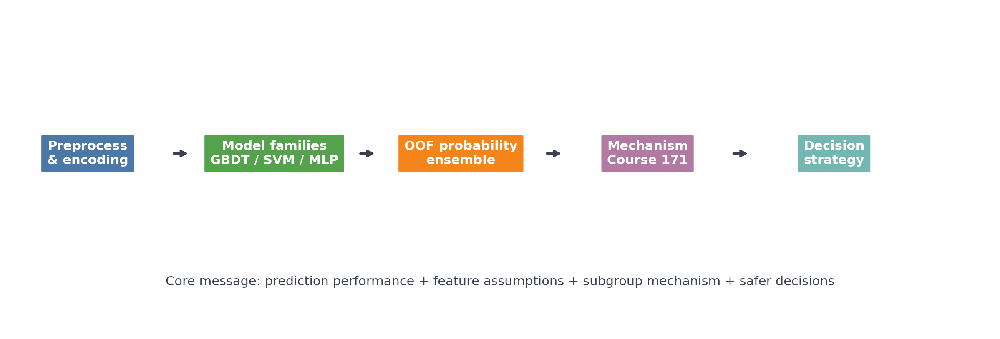
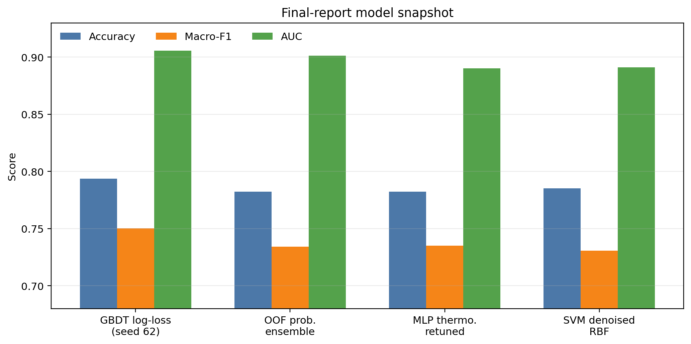
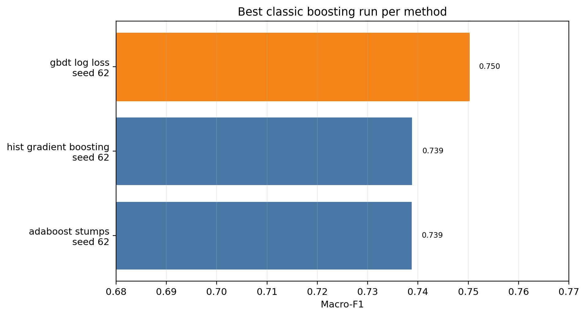
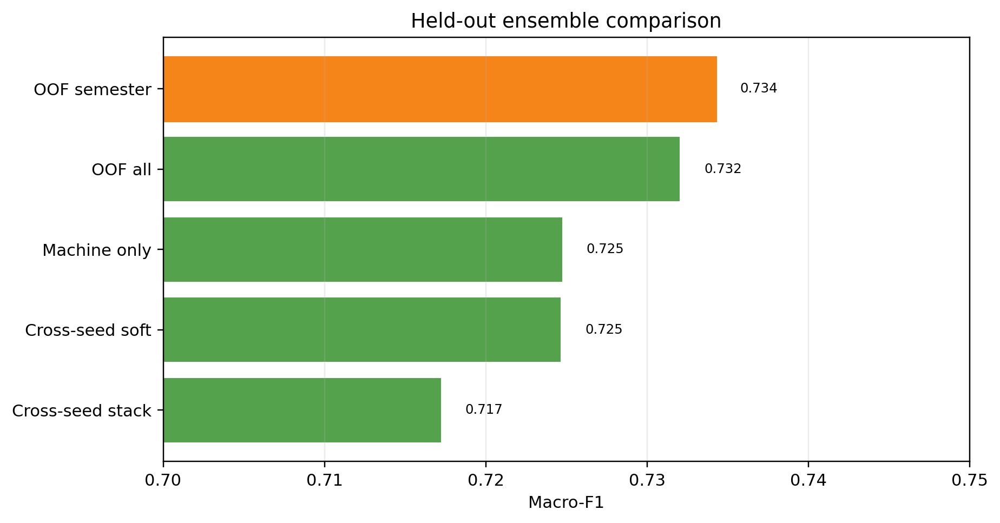
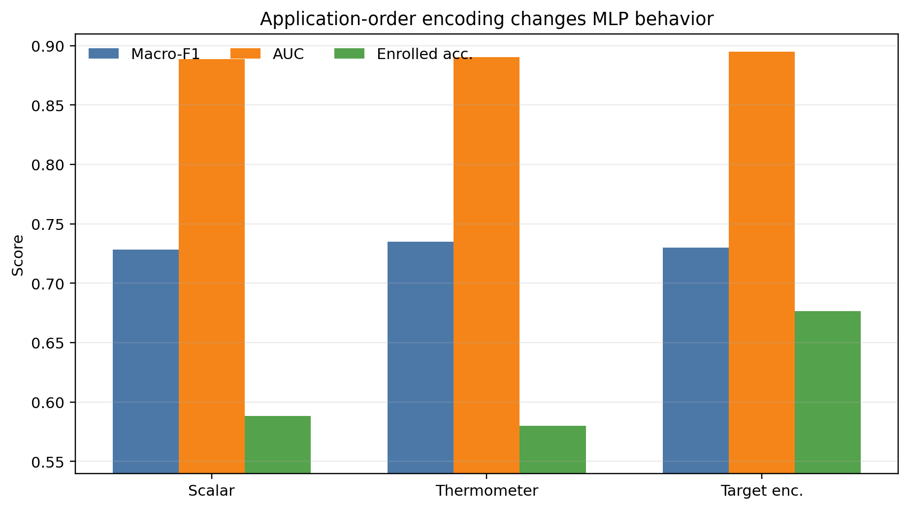
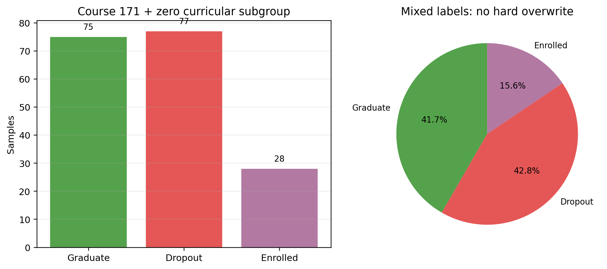
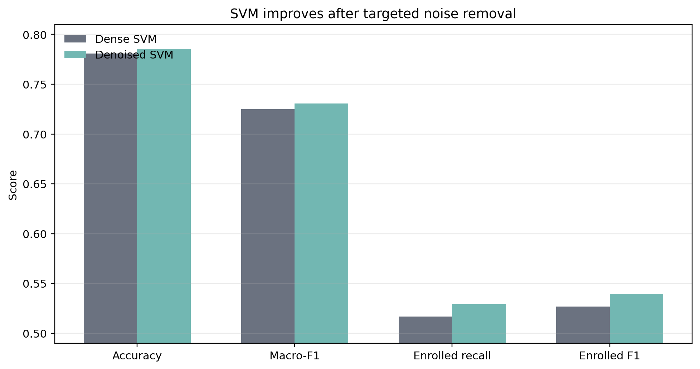

# Final Report Figures

这个文件汇总已经生成的 PPT 图片。所有图片由 `docs/final_report/make_final_report_figures.py` 从现有 metrics/docs 数据生成。

## 1. Overall Story Pipeline

用途：开场页，说明项目主线是从预测到机制发现，再到决策策略。

## 2. Overall Model Snapshot

用途：总体结果页，放 GBDT、OOF ensemble、MLP thermometer、SVM denoise 的核心指标。注意 GBDT 是 cross-seed high-score split。

## 3. GBDT / Classic Boosting Comparison

用途：解释为什么 GBDT 是强单模型。可以配合“残差迭代修正困难区域”的讲法。

## 4. Ensemble Held-out Comparison

用途：解释最终选择 OOF probability ensemble，而不是更复杂的 stacking。

## 5. MLP Encoding Comparison

用途：展示 scalar、thermometer、target encoding 对 MLP 的不同影响。

## 6. Course 171 Zero-curricular Subgroup

用途：展示 Course 171 outlier 是混合标签机制子群，不能硬规则覆盖。

## 7. SVM Denoise Before / After

用途：展示 SVM 去噪带来的 data-centric improvement，尤其是 Enrolled recall/F1。
