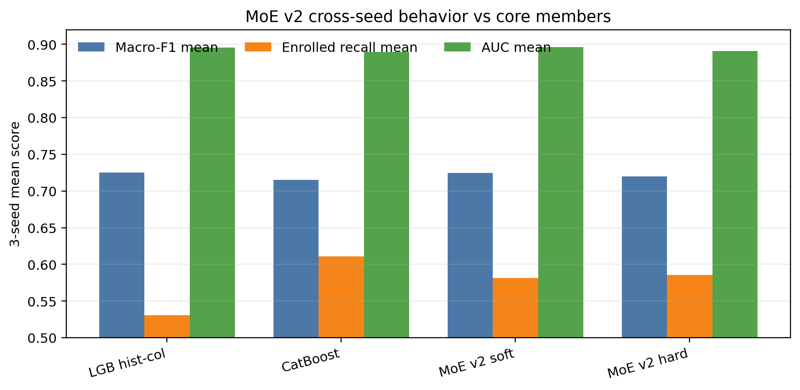

# MoE v2 Cross-seed Check

本实验用于补充 supervised error-router MoE v2 的跨 seed 稳定性。

## Evaluation Setup

- 数据：`data/processed/train.csv + test.csv` 合并后重新 stratified split。
- Seeds：`42, 62, 82`。
- Test size：`0.3`。
- MoE 配置：`v2_raw + logistic_router + weight_mode=none`。
- Router 输入：原始 tabular features。
- Expert pool：Core3，即 `catboost_tuned`、`lightgbm_hist_column_best`、`gbdt_log_loss`。
- Router CV：3-fold。
- 输出：
  - `models/metrics/reporting/all_model_results_cross_seed_seed_level.csv`
  - `models/metrics/reporting/all_model_results_cross_seed_summary.csv`
- 脚本：
  - `scripts/reporting/compile_all_models_cross_seed_summary.py`

## Cross-seed Summary

| model | Macro-F1 mean | Macro-F1 std | Accuracy mean | AUC mean | Enrolled F1 mean | Enrolled recall mean |
| --- | ---: | ---: | ---: | ---: | ---: | ---: |
| LightGBM hist-column best | 0.7252 | 0.0041 | 0.7779 | 0.8953 | 0.5332 | 0.5308 |
| MoE v2 soft routing | 0.7246 | 0.0084 | 0.7711 | 0.8962 | 0.5386 | 0.5812 |
| MoE v2 hard routing | 0.7196 | 0.0140 | 0.7661 | 0.8907 | 0.5344 | 0.5854 |
| CatBoost tuned | 0.7150 | 0.0076 | 0.7570 | 0.8894 | 0.5332 | 0.6106 |

## Interpretation

MoE v2 soft routing 的 Macro-F1 均值 `0.7246`，非常接近当前 Core3 中最强的 `lightgbm_hist_column_best` (`0.7252`)。它没有在 3-seed 均值上超过 LightGBM hist-column best，但明显高于 CatBoost tuned。

MoE v2 的主要收益不在全局 Macro-F1，而在 Enrolled 类的处理：soft routing 的 Enrolled recall 为 `0.5812`，显著高于 LightGBM hist-column best 的 `0.5308`。这说明 router 确实改变了中间类样本的决策分配。

Hard routing 的 Enrolled recall 更高 (`0.5854`)，但 Macro-F1 std 也更大 (`0.0140`)。这说明 hard routing 更激进，容易放大 seed/split 差异；soft routing 更适合作为最终汇报中的 MoE 版本。

## Report Conclusion

可以在汇报中这样表述：

> Supervised error-router MoE v2 没有稳定超过最强 LightGBM hist-column best，但它显著提高了 Enrolled recall，说明 MoE 的价值更多体现在困难中间类的动态路由，而不是简单刷新全局 leaderboard。

最终建议：

- 汇报时用 **soft routing** 作为 MoE v2 主结果。
- 不要声称 MoE v2 已经稳定超过所有单模型。
- 可以强调它是一个有解释价值的 classical ML MoE：router 学习“哪个专家更适合当前样本”，并把收益集中在 Enrolled 这类边界模糊样本上。
