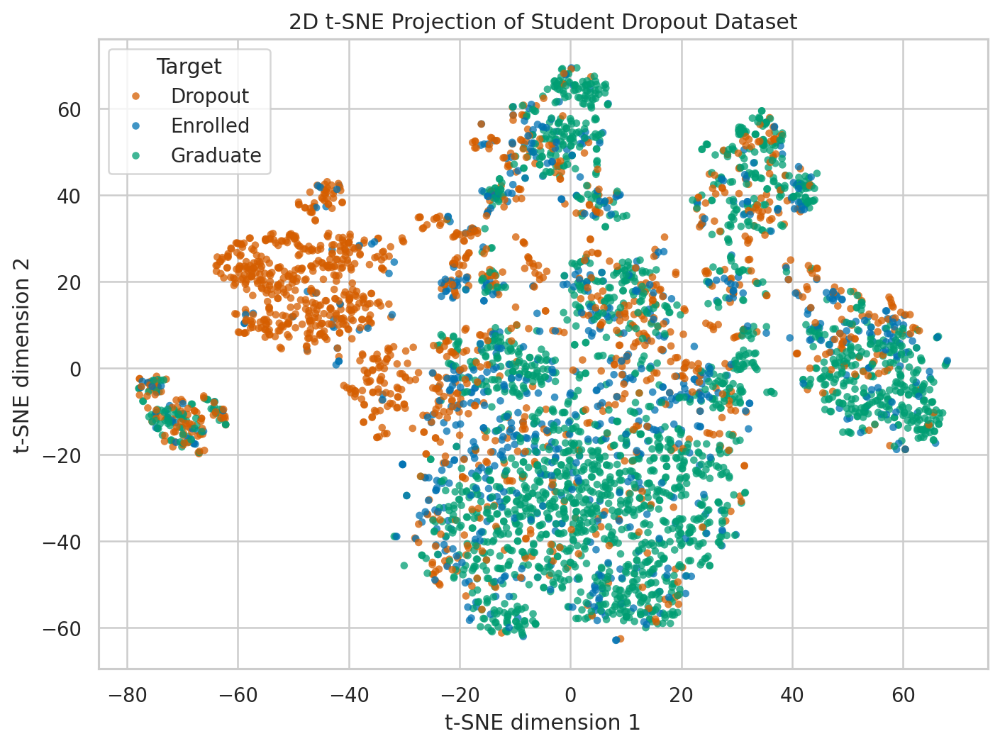
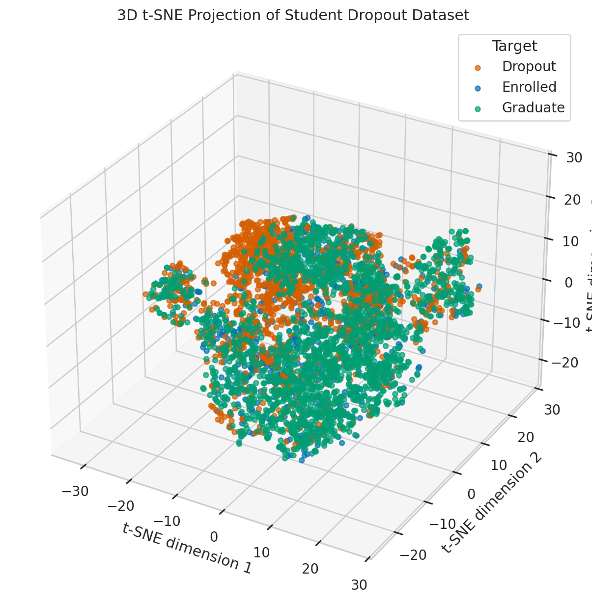
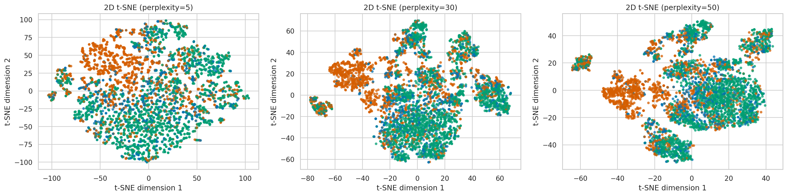

# Data Visualization and t-SNE Findings

## Objective

This section visualizes the high-dimensional Student Dropout dataset using t-SNE. The goal is to inspect whether students with different final statuses (`Dropout`, `Enrolled`, and `Graduate`) form visible local patterns in a low-dimensional space. The visualization is used for exploratory analysis only; it is not treated as a classification model.

## Method

The processed dataset contains 4,424 student records. The target column is excluded from the input feature matrix and is used only to color the scatter plots. The target mapping is:

| Encoded target | Class label |
|---:|---|
| 0 | Dropout |
| 1 | Enrolled |
| 2 | Graduate |

Before applying t-SNE, integer-coded categorical variables are one-hot encoded and continuous or ordinal numeric variables are standardized. This preprocessing is important because t-SNE is distance-based, and raw integer codes for categories should not be interpreted as continuous distances. After preprocessing, the original 36 input features become 255 encoded and scaled features.

The main t-SNE setting uses `perplexity=30`, which balances local and broader neighborhood structure for a dataset of this size. Additional 2D t-SNE projections with `perplexity=5` and `perplexity=50` are used to check whether the visual interpretation is stable. A 3D t-SNE projection with `perplexity=30` is also generated as supporting evidence.

## Dataset Overview

The target classes are moderately imbalanced:

| Target | Count | Percent |
|---|---:|---:|
| Graduate | 2,209 | 49.93% |
| Dropout | 1,421 | 32.12% |
| Enrolled | 794 | 17.95% |

This imbalance matters for scatter plot interpretation. A visually dense region may partly reflect that `Graduate` is the largest class, rather than showing stronger separability by itself.

Academic performance differs clearly across target classes:

| Target | 1st sem approved | 2nd sem approved | 1st sem grade | 2nd sem grade | Age at enrollment |
|---|---:|---:|---:|---:|---:|
| Dropout | 2.55 | 1.94 | 7.26 | 5.90 | 26.07 |
| Enrolled | 4.32 | 4.06 | 11.13 | 11.12 | 22.37 |
| Graduate | 6.23 | 6.18 | 12.64 | 12.70 | 21.78 |

Students who graduate tend to have more approved curricular units and higher semester grades. Dropout students have lower academic progress and are older on average at enrollment. Financial and administrative indicators also differ by class:

| Target | Tuition fees up to date | Debtor | Scholarship holder | Gender |
|---|---:|---:|---:|---:|
| Dropout | 0.678 | 0.220 | 0.094 | 0.493 |
| Enrolled | 0.947 | 0.113 | 0.164 | 0.387 |
| Graduate | 0.987 | 0.046 | 0.378 | 0.248 |

Graduate students are more likely to have tuition fees up to date, less likely to be debtors, and more likely to hold scholarships. The encoded gender variable also varies across target classes, but its interpretation depends on the original coding scheme.

## Feature Structure Before Visualization

Several academic performance variables are highly correlated across the first and second semesters:

| Feature pair | Absolute correlation |
|---|---:|
| 1st/2nd sem credited | 0.9448 |
| 1st/2nd sem enrolled | 0.9426 |
| 1st/2nd sem approved | 0.9040 |
| 1st/2nd sem grade | 0.8372 |

This shows that the academic performance block contains repeated information. A compact average-based screening confirms that academic progression features are the strongest target-related signals:

| Feature | Correlation with Target |
|---|---:|
| Average curricular units approved | 0.5904 |
| Average curricular units grade | 0.5504 |
| Tuition fees up to date | 0.4098 |
| Scholarship holder | 0.2976 |
| Age at enrollment | -0.2434 |
| Debtor | -0.2410 |
| Gender | -0.2293 |
| Application mode | -0.2217 |

These correlations are used only as exploratory context. They do not imply causality, and the encoded target order (`0=Dropout`, `1=Enrolled`, `2=Graduate`) affects the sign and magnitude of Pearson correlations.

A PCA baseline is used as a linear comparison before t-SNE. The first two principal components explain 33.14% of the prepared feature-space variance:

| Metric | Value |
|---|---:|
| PC1 explained variance | 0.2340 |
| PC2 explained variance | 0.0974 |
| Total explained variance | 0.3314 |
| PCA silhouette by target | 0.0032 |
| PCA Davies-Bouldin by target | 2.9621 |

The near-zero PCA silhouette score indicates that the target classes are not cleanly separated in a simple linear 2D projection. This supports using t-SNE to inspect local nonlinear neighborhood structure, while still requiring cautious interpretation.

## t-SNE Projection Results

The main 2D t-SNE projection with `perplexity=30` is displayed in the notebook as a scatter plot colored by target class. The plot shows local regions where students with similar profiles are placed near each other, but the three target classes are not separated into fully distinct clusters. `Graduate` samples appear in several dense regions, while `Dropout` and `Enrolled` samples overlap substantially with the other classes.

**Figure 1.** Main 2D t-SNE projection used as the primary visualization result. Points are colored by final student status, and the plot is the visual source for the class-overlap interpretation above.

This pattern suggests that the dataset contains meaningful local structure, especially related to academic progress and financial status, but the class boundaries are not visually clean. Students with similar enrollment, demographic, socioeconomic, and semester-performance characteristics can still have different final statuses.

The 3D t-SNE projection provides a supporting view of the same structure. It gives an additional perspective on local neighborhoods, but it also does not show complete class separation. Therefore, the 3D result should be treated as a supplement to the 2D visualization, not as stronger proof of separability.

**Figure 2.** 3D t-SNE projection used as supporting evidence. It gives another view of the local-neighborhood structure, but it still shows substantial overlap among `Dropout`, `Enrolled`, and `Graduate`.

## Sensitivity and Quality Checks

The t-SNE interpretation is checked across multiple perplexity values and with auxiliary metrics:

**Figure 3.** Perplexity sensitivity comparison. The same target-coloring scheme is used for `perplexity=5`, `30`, and `50`, allowing the visual pattern to be checked under different neighborhood scales.

| Embedding | Dimensions | Silhouette by Target | Davies-Bouldin by Target | Trustworthiness@15 | KNN Label Agreement@15 |
|---|---:|---:|---:|---:|---:|
| 2D t-SNE perplexity=5 | 2 | 0.0029 | 6.8985 | 0.9566 | 0.5780 |
| 2D t-SNE perplexity=30 | 2 | 0.0157 | 5.9721 | 0.9714 | 0.5844 |
| 2D t-SNE perplexity=50 | 2 | 0.0222 | 5.5304 | 0.9730 | 0.5919 |
| 3D t-SNE perplexity=30 | 3 | 0.0234 | 6.2471 | 0.9789 | 0.5928 |

The high trustworthiness values show that the t-SNE embeddings preserve local neighborhoods reasonably well. However, the silhouette scores are close to zero and the Davies-Bouldin scores are high, which means the target classes remain strongly overlapping in the embedded space.

The KNN label agreement values in the t-SNE spaces are higher than the random same-label baseline but lower than the prepared-space KNN agreement:

| Metric | Value |
|---|---:|
| Prepared-space KNN Label Agreement@15 | 0.6174 |
| Random Same-Label Baseline | 0.3847 |

This indicates that nearby points often share the same label more than chance would suggest, but the visualization does not preserve or reveal enough separation to classify students reliably by visual clusters alone.

## Main Findings

The visualization and supporting analyses lead to four main findings:

1. The dataset has interpretable class-related structure. Academic performance features, especially approved curricular units and semester grades, are strongly related to the final target label.
2. Financial and administrative variables also help explain local neighborhoods. Tuition-fee status, debtor status, scholarship status, and age at enrollment differ across target classes.
3. t-SNE reveals local neighborhood structure but not clean global class boundaries. `Graduate` points form denser visible regions, while `Dropout` and `Enrolled` points overlap considerably with other classes.
4. The results support using supervised learning models for prediction. Visualization alone is useful for understanding the dataset, but it is not sufficient for reliable classification.

## Limitations

t-SNE mainly preserves local neighborhoods. Cluster sizes, long-range distances, and the apparent distance between separated regions should not be interpreted as exact class frequencies or exact between-class dissimilarities. The visual density of `Graduate` points is also affected by class imbalance. Finally, correlation-based feature summaries are exploratory and do not establish causal relationships.
